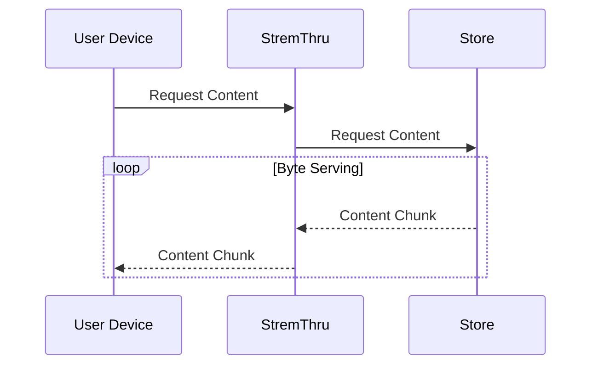
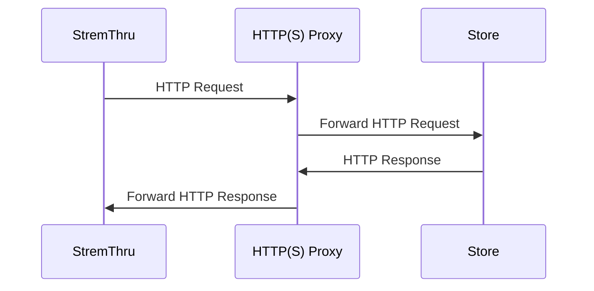

[](https://github.com/MunifTanjim/stremthru/actions/workflows/ci.yml)
[](https://github.com/MunifTanjim/stremthru/blob/master/LICENSE)

# StremThru

Companion for Stremio.

Check [documentation](https://docs.stremthru.13377001.xyz).

## Features

- HTTP(S) Proxy
- Proxy Authorization
- [Byte Serving](https://en.wikipedia.org/wiki/Byte_serving)

### Store Integration

- [AllDebrid](https://alldebrid.com)
- [Debrider](https://debrider.app)
- [Debrid-Link](https://debrid-link.com/id/4v8Uc)
- [EasyDebrid](https://easydebrid.com)
- [Offcloud](https://offcloud.com/?=ce30ae1f)
- [PikPak](https://mypikpak.com/drive/activity/invited?invitation-code=46013321)
- [Premiumize](https://www.premiumize.me/ref/634502061)
- [RealDebrid](https://stremthru.13377001.xyz/__redirect__/realdebrid-signup)
- [TorBox](https://stremthru.13377001.xyz/__redirect__/torbox-signup)
- [Torrin](https://torrin.app)

### SDK

- [JavaScript](./sdk/js)
- [Python](./sdk/py)

### Concepts

#### Store

_Store_ is an external service that provides access to content. StremThru acts as an interface for the _store_.

#### Store Content Proxy

StremThru can proxy the content from the _store_. For proxy authorized requests, this is enabled by default.



#### Store Tunnel

If you can't access the _store_ using your IP, you can use HTTP(S) Proxy to tunnel the traffic to the _store_.



### Torrent parsing and matching

- **Native (default):** StremThru uses its existing Go-PTT parser and local IMDb/AniDB matching workers.
- **[MatchLab](https://github.com/Dizzybog/MatchLab) (optional):** Configure an external parser and authoritative IMDb/AniDB matcher for release titles, video-file identities, episode ranges and mixed anime packs. Existing local matching remains the default when MatchLab is not configured.
- **Optimized Torz requests (opt-in):** With MatchLab configured, `STREMTHRU_FEATURE=+performance` uses stored torrent/file matches and asynchronously refreshes peers and indexers. Stremio stream responses still **wait for debrid cache status**, so cached availability is confirmed by the configured provider.

MatchLab and `+performance` are independent opt-ins: neither is required for the native StremThru workflow. When MatchLab is disconnected, the optimized file lookup automatically falls back to the original Torz path.

## Configuration

For an optional MatchLab deployment, configure a reachable API base URL (and optionally adjust the request timeout and concurrency):

```env
STREMTHRU_INTEGRATION_MATCHLAB_URL=http://matchlab:8765
STREMTHRU_INTEGRATION_MATCHLAB_TIMEOUT=10s
STREMTHRU_INTEGRATION_MATCHLAB_CONCURRENCY=8
```

Enable optimized Torz lookup only if desired:

```env
STREMTHRU_FEATURE=+performance
```

See the [MatchLab integration guide](./docs/integrations/matchlab.md) for setup and compatibility, the [mapping design notes](./docs/matchlab.md) for data flow and recovery, and the [feature documentation](./docs/configuration/features.md) for opt-in flags.

Check [documentation](https://docs.stremthru.13377001.xyz/configuration).

### Stremio Addons

Check [documentation](https://docs.stremthru.13377001.xyz/stremio-addons).

## Sponsors

- [DanaramaPyjama](https://x.com/danaramaps4)
- [Debridio](https://debridio.com)
- [FunkyPenguin](https://github.com/funkypenguin)

## License

Licensed under the MIT License. Check the [LICENSE](./LICENSE) file for details.
